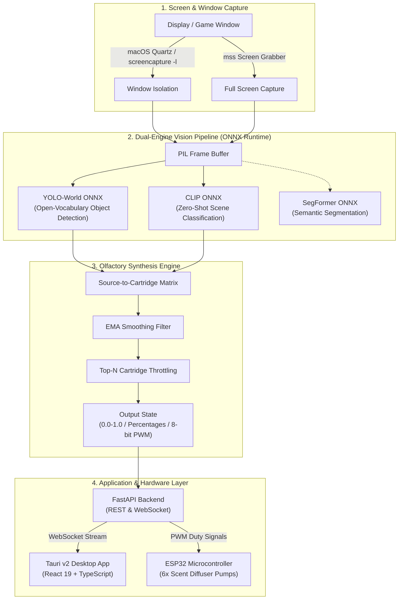

# SmellEngine (AI-Scent)

<div align="center">

**Real-Time Artificial Olfaction & Environmental Scent Synthesis System for Video Games, Movies, and Virtual Reality**

[](https://www.python.org/)
[](https://fastapi.tiangolo.com/)
[](https://onnxruntime.ai/)
[](https://tauri.app/)
[](https://react.dev/)
[](https://www.typescriptlang.org/)
[](#prerequisites)
[](LICENSE)


</div>

---

## Overview

**SmellEngine** (internally known as `ai-scent`) is an intelligent real-time olfactory feedback system designed to immerse gamers and multimedia viewers by synthesizing physical aromas that match the visual scenery on screen.

By combining low-latency screen/window capture, state-of-the-art vision models (**YOLO-World** and **CLIP** running on **ONNX Runtime**), an olfactory semantic mapping matrix, and real-time exponential smoothing, the system translates visual entities and atmospheric scenes into precise **PWM intensity signals** that actuate a 6-cartridge scent diffuser driven by an **ESP32** microcontroller.

> **Academic Context**: Developed by **Daniil Zhdanov** as a research and engineering project for the **Master 1 IAFA** (Intelligence Artificielle et ses Formations Associées) program at **Université Paul Sabatier (Toulouse, France)**.

---

## System Architecture



---

## Key Features

- ** Native Low-Latency Capture**:
  - Isolated window capture via macOS `screencapture -l<window_id> -x` (silent, zero-overlay interference).
  - High-speed desktop screen capture via `mss`.
  - Dynamic macOS window enumeration via `AppKit` and `Quartz` (`CGWindowListCopyWindowInfo`).
- ** Dual Computer Vision Pipeline**:
  - **YOLO-World (ONNX Runtime)**: Real-time detection of open-vocabulary objects and terrain elements (fire, smoke, water, waves, trees, asphalt, soil, rain, vehicles) with pixel-bounding boxes and surface area tracking.
  - **CLIP (Contrastive Language-Image Pre-Training, ONNX Runtime)**: Zero-shot environmental classification utilizing paired positive/negative contrastive prompts with pre-computed text embeddings for near-instant inference.
  - **SegFormer (ONNX Runtime)**: Semantic landscape segmentation module for granular pixel-level surface area calculations.
- ** Intelligent Scent Synthesis (`RuntimeSmellEngine`)**:
  - **Exponential Moving Average (EMA)** smoothing ($\alpha = 0.35 - 0.5$) prevents jarring scent transitions and olfactory fatigue.
  - **Deadband change thresholding** ($> 5\%$) minimizes unnecessary hardware actuation.
  - **Top-N Cartridge Limiter**: Constrains diffusion to at most 3 simultaneous active scents to prevent olfactory dissonance.
  - **Multi-Format Output**: Exposes normalized floats (`[0.0, 1.0]`), percentages (`0–100%`), and 8-bit PWM values (`0–255`).
- ** Cyberpunk Desktop Dashboard (Tauri v2 + React 19)**:
  - Live annotated preview feed displaying bounding boxes, class labels, and telemetry HUD.
  - Live target window selector dropdown.
  - Real-time cartridge intensity gauges and active CLIP confidence metrics.
  - Sub-millisecond latency breakdowns (Capture, Detection, Classification, Total FPS).
  - Integrated runtime event logger.
  - Network-aware IP auto-detection for cross-device & mobile telemetry.
- ** Hardware Ready (ESP32)**:
  - Real-time WebSocket and serial-compatible PWM payload distribution for direct motor/ultrasonic atomizer control.

---

## Scent Palette & Mapping Matrix

The engine maps environmental triggers across **6 physical fragrance cartridges**:

| Cartridge | Aroma Profile | Primary Visual & Scene Triggers | Associated Scent Sources |
|:---|:---|:---|:---|
| 🌲 **Pine** | Fresh conifer needles, evergreen bark | Coniferous forests, spruce trees, pine groves, mountain woods | `coniferous_forest` |
| 🌍 **Earth** | Wet soil, decaying leaves, moss, dirt | Mud, unpaved terrain, broadleaf woodlands, jungle floors | `soil_mud`, `broadleaf_forest` |
| 🌊 **Ocean** | Marine salt breeze, sea spray, coastal air | Open ocean, coastal beaches, sea foam, rivers, lakes | `ocean_sea` |
| 💨 **Smoke** | Acrid smoke, ash, burning embers, ozone | Wildfires, bonfires, explosions, gunfire battlefields, tire burnout | `smoke_fire`, `explosions`, `combat_action`, `racing_speed` |
| 🌧️ **Rain** | Petrichor, humid precipitation, wet stones | Rain streaks, glossy wet asphalt, puddles, stormy weather | `rain_wetness` |
| 🛣️ **Asphalt** | Warm bitumen, hot tires, urban concrete | City highways, paved roads, parking lots, race circuits | `asphalt_city`, `racing_speed` |

---

## Project Structure

```text
ai-scent/
├── backend/                  # FastAPI backend server
│   ├── app.py                # Main API service, WebSocket hub, loop manager
│   └── window_manager.py     # macOS Quartz / AppKit window discovery
├── scent_ai/                 # Computer vision & olfactory synthesis core
│   ├── config.py             # Scent sources, CLIP prompts, cartridge mappings
│   ├── runtime.py            # RuntimeSmellEngine (smoothing, thresholds, PWM)
│   ├── smell_engine.py       # Core classification & score aggregation logic
│   ├── yolo_world.py         # YOLO-World ONNX detector & bounding-box logic
│   ├── clip_classifier.py    # Dual ONNX CLIP encoder & cached text embeddings
│   ├── segmentation_onnx.py  # SegFormer ONNX semantic segmentation model
│   └── capture.py            # macOS screencapture + mss screen capture engine
├── models/                   # Pre-trained ONNX models & embedding caches
│   ├── yolov8s-world.onnx    # Quantized/exported YOLO-World weights
│   ├── clip_onnx/            # CLIP text/image ONNX encoders & cached embeddings
│   └── segformer_onnx/       # SegFormer landscape segmentation model
├── src/                      # React 19 frontend application
│   ├── App.tsx               # Main dashboard UI, metrics, video feed & state
│   ├── App.css               # Futuristic dark-mode dashboard styling
│   └── main.tsx              # React DOM entry point
├── src-tauri/                # Tauri v2 desktop application wrapper
│   ├── src/lib.rs            # Rust entry point & sidecar process manager
│   ├── Cargo.toml            # Rust dependencies & configuration
│   └── tauri.conf.json       # Tauri window, sidecar, and bundling specs
├── conversion/               # Embedding generation & optimization scripts
├── scent-engine.spec         # PyInstaller build specification for backend binary
├── requirements.txt          # Python dependencies
├── package.json              # Frontend scripts & Node dependencies
└── README.md                 # Project documentation
```

---

## Getting Started

### Prerequisites

- **Operating System**: macOS (tested on macOS 14 Sonoma / 15 Sequoia; Screen Recording permissions required in *System Settings → Privacy & Security → Screen Recording*).
- **Python**: 3.11+
- **Node.js**: 18+ and `npm`
- **Rust Toolchain**: Required for compiling Tauri desktop binaries ([rustup.rs](https://rustup.rs/)).

---

### Installation

1. **Clone the repository**:
   ```bash
   git clone https://github.com/yeezysmem/ai-scent.git
   cd ai-scent
   ```

2. **Set up the Python backend environment**:
   ```bash
   python3.11 -m venv venv
   source venv/bin/activate
   pip install --upgrade pip
   pip install -r requirements.txt
   ```

3. **Install frontend dependencies**:
   ```bash
   npm install
   ```

4. **Verify ONNX Models**:
   Ensure pre-trained models are located in `models/`:
   - `models/yolov8s-world.onnx`
   - `models/clip_onnx/clip_text_encoder.onnx`, `models/clip_onnx/clip_image_encoder.onnx`, `models/clip_onnx/cached_text_embeds.pt`
   - *(Optional)* `models/segformer_onnx/segformer.onnx`

---

## 🏃 Running the Application

### Option 1: Full Desktop Application (Recommended)

Launch the full desktop application using Tauri. This runs Vite development server alongside the Rust application shell:

```bash
# Terminal 1: Run the Python backend
source venv/bin/activate
python -m uvicorn backend.app:app --host 0.0.0.0 --port 8000 --reload

# Terminal 2: Run the Tauri desktop app
npm run tauri dev
```

### Option 2: Web Dashboard Mode (Browser / Mobile)

You can run and interact with the system entirely through your web browser (or from a smartphone on the same local network):

```bash
# Terminal 1: Start Backend
source venv/bin/activate
python -m uvicorn backend.app:app --host 0.0.0.0 --port 8000 --reload

# Terminal 2: Start Vite Dev Server
npm run dev
```

- **Desktop UI**: Open `http://localhost:5173`
- **Mobile / Remote UI**: Open `http://<YOUR_LOCAL_IP>:5173`

---

## 📡 Backend API Reference

The FastAPI backend exposes both a RESTful interface and a duplex WebSocket connection on port `8000`.

### REST Endpoints

| Method | Endpoint | Description |
|:---|:---|:---|
| `GET` | `/health` | Returns health status of models, capture pipeline, and runtime. |
| `GET` | `/ip` | Returns host machine's LAN IP address for remote access. |
| `GET` | `/windows` | Returns a list of all visible on-screen application windows with IDs. |
| `POST` | `/windows/select/{id}` | Targets capture to a specific window (`0` resets to full screen). |
| `POST` | `/start` | Starts the background asynchronous capture and analysis loop. |
| `POST` | `/stop` | Stops the background capture loop and resets cartridge values. |
| `GET` | `/state` | Returns the current cartridge levels, percentages, and PWM values. |
| `GET` | `/preview` | Returns a live JPEG frame annotated with bounding boxes & HUD stats. |
| `POST` | `/force-update` | Manually triggers an immediate WebSocket broadcast with the latest state. |
| `GET` | `/segmentation` | Returns raw colored semantic segmentation overlay. |

### WebSocket Endpoint (`/ws`)

Connect to `ws://localhost:8000/ws` to receive real-time JSON frames at each capture cycle:

```json
{
  "status": "ok",
  "screenshot_size": { "width": 1920, "height": 1080 },
  "cartridges": {
    "pine": 0.85,
    "earth": 0.15,
    "ocean": 0.0,
    "smoke": 0.0,
    "rain": 0.0,
    "asphalt": 0.0
  },
  "percentages": { "pine": 85, "earth": 15, "ocean": 0, "smoke": 0, "rain": 0, "asphalt": 0 },
  "pwm": { "pine": 217, "earth": 38, "ocean": 0, "smoke": 0, "rain": 0, "asphalt": 0 },
  "sources": { "coniferous_forest": 0.88, "broadleaf_forest": 0.12 },
  "scene_areas": { "tree": 0.42, "grass": 0.18 },
  "should_send": true,
  "metrics": {
    "capture_time_ms": 14.2,
    "process_time_ms": 78.5,
    "classification_time_ms": 47.1,
    "detection_time_ms": 31.4,
    "total_time_ms": 92.7,
    "fps": 10.8,
    "timestamp": "14:22:05"
  }
}
```

---

## Production Build & Packaging

To compile a self-contained production desktop application:

1. **Build Python Sidecar Binary**:
   ```bash
   source venv/bin/activate
   pyinstaller scent-engine.spec --noconfirm
   mkdir -p src-tauri/bin
   cp dist/scent-engine src-tauri/bin/scent-engine-x86_64-apple-darwin # (or aarch64-apple-darwin)
   ```

2. **Build Tauri Desktop Bundle**:
   ```bash
   npm run tauri build
   ```
   The compiled `.dmg` or `.app` bundle will be generated in `src-tauri/target/release/bundle/`.

---

## 🗺️ Roadmap

- [x] Dual Vision Pipeline integration (YOLO-World + CLIP ONNX)
- [x] Native macOS Quartz window & display capture
- [x] Exponential Moving Average (EMA) and Top-N cartridge limiter
- [x] High-performance FastAPI server with WebSocket telemetry
- [x] Tauri v2 + React 19 desktop admin dashboard
- [x] Live annotated preview overlay generation
- [ ] ESP32 MicroPython / C++ firmware integration via WebSockets / Serial
- [ ] Cross-platform support for Windows (Win32 / Desktop Duplication API) & Linux (X11 / Wayland)
- [ ] User-customizable fragrance cartridge profiles and custom prompt sets

---

## Author

**Daniil Zhdanov**  
*Master 1 IAFA — Université Paul Sabatier (Toulouse, France)*

- **GitHub**: [@yeezysmem](https://github.com/yeezysmem)
- **LinkedIn**: [Daniil Zhdanov](https://www.linkedin.com/in/zhdanov-dan/)
- **Email**: [d.zhdanov.dev@gmail.com](mailto:d.zhdanov.dev@gmail.com)

---

## Getting Started

### Prerequisites

- **Operating System**: macOS (tested on macOS 14 Sonoma / 15 Sequoia; Screen Recording permissions required in *System Settings → Privacy & Security → Screen Recording*).
- **Python**: 3.11+
- **Node.js**: 18+ and `npm`
- **Rust Toolchain**: Required for compiling Tauri desktop binaries ([rustup.rs](https://rustup.rs/)).

---

### Installation

1. **Clone the repository**:
   ```bash
   git clone https://github.com/yeezysmem/ai-scent.git
   cd ai-scent
   ```

2. **Set up the Python backend environment**:
   ```bash
   python3.11 -m venv venv
   source venv/bin/activate
   pip install --upgrade pip
   pip install -r requirements.txt
   ```

3. **Install frontend dependencies**:
   ```bash
   npm install
   ```

4. **Verify ONNX Models**:
   Ensure pre-trained models are located in `models/`:
   - `models/yolov8s-world.onnx`
   - `models/clip_onnx/clip_text_encoder.onnx`, `models/clip_onnx/clip_image_encoder.onnx`, `models/clip_onnx/cached_text_embeds.pt`
   - *(Optional)* `models/segformer_onnx/segformer.onnx`

---

## Running the Application

### Option 1: Full Desktop Application (Recommended)

Launch the full desktop application using Tauri. This runs Vite development server alongside the Rust application shell:

```bash
# Terminal 1: Run the Python backend
source venv/bin/activate
python -m uvicorn backend.app:app --host 0.0.0.0 --port 8000 --reload

# Terminal 2: Run the Tauri desktop app
npm run tauri dev
```

### Option 2: Web Dashboard Mode (Browser / Mobile)

You can run and interact with the system entirely through your web browser (or from a smartphone on the same local network):

```bash
# Terminal 1: Start Backend
source venv/bin/activate
python -m uvicorn backend.app:app --host 0.0.0.0 --port 8000 --reload

# Terminal 2: Start Vite Dev Server
npm run dev
```

- **Desktop UI**: Open `http://localhost:5173`
- **Mobile / Remote UI**: Open `http://<YOUR_LOCAL_IP>:5173`

---

## Backend API Reference

The FastAPI backend exposes both a RESTful interface and a duplex WebSocket connection on port `8000`.

### REST Endpoints

| Method | Endpoint | Description |
|:---|:---|:---|
| `GET` | `/health` | Returns health status of models, capture pipeline, and runtime. |
| `GET` | `/ip` | Returns host machine's LAN IP address for remote access. |
| `GET` | `/windows` | Returns a list of all visible on-screen application windows with IDs. |
| `POST` | `/windows/select/{id}` | Targets capture to a specific window (`0` resets to full screen). |
| `POST` | `/start` | Starts the background asynchronous capture and analysis loop. |
| `POST` | `/stop` | Stops the background capture loop and resets cartridge values. |
| `GET` | `/state` | Returns the current cartridge levels, percentages, and PWM values. |
| `GET` | `/preview` | Returns a live JPEG frame annotated with bounding boxes & HUD stats. |
| `POST` | `/force-update` | Manually triggers an immediate WebSocket broadcast with the latest state. |
| `GET` | `/segmentation` | Returns raw colored semantic segmentation overlay. |

### WebSocket Endpoint (`/ws`)

Connect to `ws://localhost:8000/ws` to receive real-time JSON frames at each capture cycle:

```json
{
  "status": "ok",
  "screenshot_size": { "width": 1920, "height": 1080 },
  "cartridges": {
    "pine": 0.85,
    "earth": 0.15,
    "ocean": 0.0,
    "smoke": 0.0,
    "rain": 0.0,
    "asphalt": 0.0
  },
  "percentages": { "pine": 85, "earth": 15, "ocean": 0, "smoke": 0, "rain": 0, "asphalt": 0 },
  "pwm": { "pine": 217, "earth": 38, "ocean": 0, "smoke": 0, "rain": 0, "asphalt": 0 },
  "sources": { "coniferous_forest": 0.88, "broadleaf_forest": 0.12 },
  "scene_areas": { "tree": 0.42, "grass": 0.18 },
  "should_send": true,
  "metrics": {
    "capture_time_ms": 14.2,
    "process_time_ms": 78.5,
    "classification_time_ms": 47.1,
    "detection_time_ms": 31.4,
    "total_time_ms": 92.7,
    "fps": 10.8,
    "timestamp": "14:22:05"
  }
}
```

---

## 🛠️ Production Build & Packaging

To compile a self-contained production desktop application:

1. **Build Python Sidecar Binary**:
   ```bash
   source venv/bin/activate
   pyinstaller scent-engine.spec --noconfirm
   mkdir -p src-tauri/bin
   cp dist/scent-engine src-tauri/bin/scent-engine-x86_64-apple-darwin # (or aarch64-apple-darwin)
   ```

2. **Build Tauri Desktop Bundle**:
   ```bash
   npm run tauri build
   ```
   The compiled `.dmg` or `.app` bundle will be generated in `src-tauri/target/release/bundle/`.

---

## Roadmap

- [x] Dual Vision Pipeline integration (YOLO-World + CLIP ONNX)
- [x] Native macOS Quartz window & display capture
- [x] Exponential Moving Average (EMA) and Top-N cartridge limiter
- [x] High-performance FastAPI server with WebSocket telemetry
- [x] Tauri v2 + React 19 desktop admin dashboard
- [x] Live annotated preview overlay generation
- [ ] ESP32 MicroPython / C++ firmware integration via WebSockets / Serial
- [ ] Cross-platform support for Windows (Win32 / Desktop Duplication API) & Linux (X11 / Wayland)
- [ ] User-customizable fragrance cartridge profiles and custom prompt sets

---


